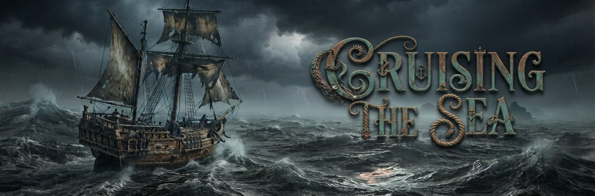

# RageMatter Labs

  

**RageMatter Labs** present Crusing The Sea.

# Crushing the Sea

  

**Crushing the Sea** is a multiplayer survival, exploration, and naval adventure game developed by **RageMatter Labs** on Roblox.

Set in a mysterious and dangerous ocean, players must work together aboard an old wooden ship, manage resources, survive unpredictable disasters, explore distant islands, and face terrifying creatures lurking beneath the waves.

But survival is only half the challenge. Your ultimate objective is to travel **60 kilometres across the ocean**, reach the final island, assemble a helicopter from scattered parts, and escape.

**Will your crew make it out alive, or will the ocean claim you?**

---

## 01. Game Overview

| Information | Details |
| :--- | :--- |
| **Title** | Crushing the Sea |
| **Developer** | RageMatter Labs |
| **Platform** | Roblox |
| **Genre** | Multiplayer Survival / Naval Adventure / Exploration |
| **Game Status** | In Development |

## 02. The Main Objective

Your journey begins in the middle of a vast and dangerous ocean.

To complete the game, your crew must:

1. Travel across the ocean and explore islands.
2. Survive dangerous creatures, disasters, and rival threats.
3. Collect resources, fuel, supplies, and valuable loot.
4. Reach the final island located approximately 60 kilometres away.
5. Find all the scattered helicopter components.
6. Assemble the helicopter and escape.

**The ultimate objective is simple: survive the journey and escape the ocean.**

---

## 03. The Ship

Your primary means of transportation is an old wooden ship. It is your home, transport, and most important survival asset.

Keeping it operational requires teamwork, resources, and constant maintenance.

### Ship Systems

- **Steering:** Players must manually control the ship's steering to navigate the ocean.
- **Engine:** The ship operates using Heavy Fuel Oil (HFO).
- **Repairs:** Wood is used exclusively for repairing ship damage.
- **Maintenance:** Engine problems, fuel leaks, and water leaks must be addressed to keep the vessel operational.

### Starting Equipment

Every crew begins with two essential navigation tools.

**Map**
- Displays all islands and their distances.
- Shows the ship's current progress.
- Indicates how many kilometres remain until the destination.

**Compass**
- Displays a directional arrow.
- Guides players towards their next destination.
- Players must steer the ship according to the compass direction.

---

## 04. Fuel System

The ship requires Heavy Fuel Oil (HFO) to operate. Without fuel, the engine stops and the ship becomes stranded.

**Fuel Sources:**
- Islands
- Merchant's Huts at Outposts

**Fuel Mechanics:**
- HFO is stored in fuel cans.
- Outposts appear approximately every 10 kilometres.
- Players must collect HFO cans to refill the ship's tank.
- Running out of fuel in the middle of the ocean will stop the ship.

Wood cannot be used as engine fuel.

---

## 05. Ship Problems

Unexpected mechanical problems can occur approximately every 15–20 minutes. Players will not know exactly when the next problem will happen.

| Problem | Description |
| :--- | :--- |
| **Water Leak** | Water begins entering the ship. Players must use wood to repair the damaged area. |
| **Engine Leak** | HFO starts leaking from the engine and must be repaired immediately. |
| **Engine Malfunction** | The engine stops functioning properly and requires maintenance. |

Ignoring these problems can put the entire crew at risk.

---

## 06. Outposts

Outposts appear approximately every 10 kilometres and provide essential services for surviving the journey.

| Location | Purpose |
| :--- | :--- |
| **Merchant's Hut** | Purchase fuel and general resources. |
| **Medic Shop** | Purchase medicines and medical supplies. |
| **Weapon Shop** | Purchase weapons and ammunition. |
| **Selling Point** | Sell collected loot in exchange for money. |

---

## 07. Ocean Disasters

As players travel further into the ocean, increasingly dangerous events await them.

| Distance | Disaster | Description |
| :--- | :--- | :--- |
| **15 KM** | Storm | A dangerous storm strikes the ocean. |
| **30 KM** | Whirlpool | A massive whirlpool threatens nearby vessels. |
| **45 KM** | Fog | Dense fog reduces visibility across the ocean. |
| **60 KM** | Pirate Ambush | Rival pirates attack near the final island. |

---

## 08. Creatures of the Ocean

The ocean is home to creatures that make every journey unpredictable.

### Zombie Pirates
- Found exclusively on islands.
- Hostile undead pirates that attack players.

### Mist Walkers
- Emerge from the water during normal nights.
- Can catch players who enter the water at night.
- May randomly climb aboard ships when they stop at night.
- Do not appear during the daytime.

### Deep Ones
- Half-human, half-sea-creature entities.
- Stronger and faster than Mist Walkers.
- Appear exclusively during Deep Nights.
- Usually attack in groups.

### Night Types

**Normal Night**
- Mist Walkers emerge from the ocean.
- Travelling through or entering the water becomes dangerous.

**Deep Night**
- A special night that can occur randomly.
- The ocean turns an extremely dark black.
- Mist Walkers disappear.
- Groups of Deep Ones emerge from the depths.

---

## 09. Exploration Locations

Beyond the ordinary islands and outposts, players can discover dangerous locations containing valuable treasures and unique encounters.

### Shipwrecks

Abandoned ships, partially submerged beneath the water.

**Features:**
- Drowned Pirates armed with cutlasses.
- Treasure chests containing gold coins.
- Valuable golden statues.
- Potential treasure maps leading to hidden treasures.

### Ghost Ships

Mysterious vessels inhabited by ghost pirates, surrounded by a light fog.

**Features:**
- Ghost Pirates armed with flintlocks and cutlasses.
- Valuable loot after defeating enemies.
- Rare weapons and medical supplies.

**Potential Loot:**
- 2 Hand Cannons
- 4 Sniper Muskets
- Bandages
- Other valuable resources

### Coral Cave

A mysterious cave located on an island, filled with coral formations and dangerous Deep Ones.

**Features:**
- Deep Ones guarding the cave.
- Valuable loot and resources.
- A hidden chamber containing a unique weapon.

**Exclusive Item — Trident of the Deep One**

A powerful melee weapon located inside the Coral Cave. Only one player can claim it.

### Sunken Temple

The most dangerous exploration location currently planned.

An ancient underwater temple dedicated to the **Abyssal Lord**, the deity worshipped by the Abyssal Hordes.

**Features:**
- A massive statue of the Abyssal Lord.
- Statues of the Abyssal Hordes.
- Extremely dangerous enemies guarding the temple.
- Valuable treasures hidden throughout the structure.

**The Abyssal Lord's Statue**

The temple's most valuable treasure. Players must defeat all Abyssal Hordes before obtaining it.

The statue can be sold for a significant amount of money.

---

## 10. Progression & Loot

Exploration is essential for survival and progression.

Players can discover and collect:

- Fuel and repair materials.
- Weapons and ammunition.
- Medical supplies.
- Gold coins and valuable statues.
- Rare equipment and unique items.
- Hidden treasures and treasure maps.

Collected loot can be sold at Outposts to earn money, which can then be used to purchase additional supplies.

---

## 11. The Final Escape

At approximately 60 kilometres, players reach the final island.

However, reaching the island does not guarantee victory.

A pirate ambush awaits near the destination, and players must survive the encounter before searching for the helicopter components.

Once all required parts have been collected, the crew must assemble the helicopter.

**Escape is the final objective.**

---

## 12. Development Team

**RageMatter Labs**

An independent game development studio focused on creating engaging, creative, and memorable gaming experiences.

### Leadership

| Position | Member |
| :--- | :--- |
| **Founder** | `aesthetic.vexon` |
| **Co-Founder / CEO** | `atomicarc002` |
| **Co-Founder / CEO** | `mclox_79` |

### Game Development

- **Game Writer:** MCLOX
- **Additional Game Design:** ShadowDriftXD

---

## 13. Studio

### RageMatter Labs

RageMatter Labs is an independent game development studio focused on creating immersive gameplay experiences and original concepts.

Our current project, **Crushing the Sea**, aims to bring cooperative survival, naval exploration, and unpredictable ocean encounters together into one experience.

**RageMatter Labs — Creating Beyond Expectations.**

---

*Survive the ocean. Maintain your ship. Trust your crew. Conquer the sea.*